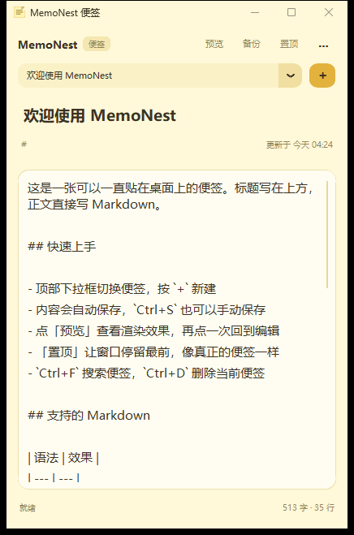
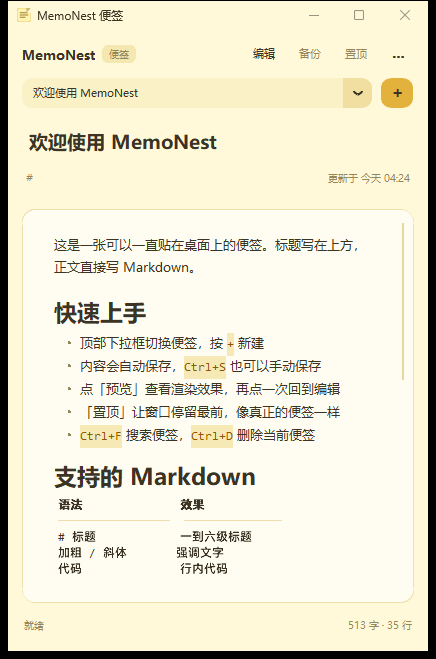
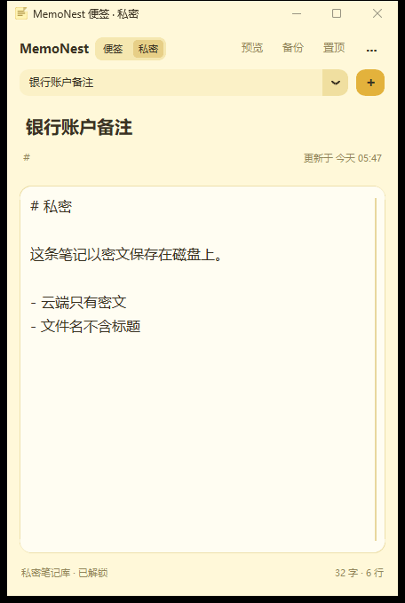
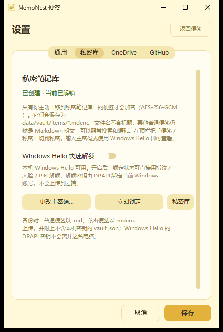

# MemoNest 便签

一个像便签纸一样贴在桌面角落的 Markdown 备忘录：小窗口、黄色纸面、自动保存、
支持 OneDrive 云备份、GitHub 同步和开机自启。比较私密的便签可以单独放进
**私密笔记库**，用主密码或 Windows Hello 解锁，其余便签仍然保持 Markdown 明文。

界面使用 [CustomTkinter](https://github.com/TomSchimansky/CustomTkinter) 绘制，
圆角卡片 + 与纸面同色的标题栏，运行时内存约 40–60 MB，不需要 Electron 或 Qt。



<details>
<summary>Markdown 预览效果</summary>



</details>

<details>
<summary>私密笔记库</summary>





</details>

## 功能

- **小便签窗口**：默认 420×620，单条笔记视图，可置顶、记忆窗口位置和大小
- **Markdown**：编辑 + 应用内渲染预览，支持标题、列表、任务列表、表格、代码块、引用、链接
- **基础备忘录**：新建、下拉切换、搜索、标签、置顶笔记、删除（进回收站）、导出 `.md`
- **选择性私密库**：只把私密便签移进去，逐条 AES-256-GCM 加密；顶栏「便签 / 私密」切换，主密码或 Windows Hello 解锁
- **自动保存**：停止输入约 1 秒后写入磁盘，关闭窗口时也会保存
- **OneDrive 云备份**：两种方式——镜像到 OneDrive 同步文件夹，或直接登录 Microsoft 账号用 Graph API 上传
- **GitHub 同步**：把笔记以 Markdown 文件提交并推送到你的仓库，私密便签只上传密文
- **备份策略**：手动、定时（分钟）、退出前自动备份
- **开机自启**：写入当前用户注册表 `Run` 项，可在设置中开关
- **本地优先**：普通便签就是 `data/notes/*.md`，任何编辑器都能打开

## 环境要求

- Windows 10 / 11
- Python 3.10+（安装时勾选 tcl/tk，默认已包含）
- 可选：OneDrive 客户端、Git（用于 GitHub 同步）
- 依赖：`customtkinter`、`cryptography`、`winrt-*`（Windows Hello）

## 快速开始

直接双击 **`start.bat`** 即可。首次运行会自动：

1. 在项目内创建 `.venv` 虚拟环境（不污染系统 Python）
2. 安装 `requirements.txt` 里的 CustomTkinter
3. 用 `pythonw.exe` 启动，不留控制台窗口

通过 `start.bat` 启动时不会留下控制台窗口；也可以直接双击 **`MemoNest.pyw`**
（`.pyw` 由 `pythonw.exe` 打开）。手动启动：

```powershell
python -m venv .venv
.\.venv\Scripts\python.exe -m pip install -r requirements.txt
.\.venv\Scripts\pythonw.exe app.py
```

> 若你的 Python 来自 MSYS2 / Git Bash，虚拟环境目录是 `.venv\bin\` 而不是
> `.venv\Scripts\`，`start.bat` 会自动识别两种布局。

首次启动会自动创建 `data/notes/` 和一篇欢迎便签。私密笔记库不会自动出现，
只有在「设置 → 私密库」里主动创建后才会生成 `data/vault/`。

## 界面

```
┌────────────────────────────────────────────┐
│ MemoNest 便签                    ─  □  ×  │  ← 标题栏配色随纸面
├────────────────────────────────────────────┤
│ MemoNest [便签|私密]     预览  备份  置顶 ⋯ │
│ [ 欢迎使用 MemoNest                      ⌄ ] + │
│ 标题                                        │
│ # 标签                    更新于 今天 04:24 │
│ ┌────────────────────────────────────────┐ │
│ │ 正文（Markdown）                       │ │
│ └────────────────────────────────────────┘ │
│ 就绪                            513 字 · 35 行 │
└────────────────────────────────────────────┘
```

- **便签 / 私密**：顶栏分段按钮切换普通库与私密库；切到私密时才要求解锁
- **预览 / 备份 / 置顶**：常用操作放在顶栏，一眼可见
- **⋯ 菜单**：新建、保存、导出、搜索、删除、设置，以及「移到私密笔记库」等
- 没有传统的「文件 / 编辑 / 视图」菜单栏，窗口更像一张便签

## 使用

| 操作 | 方式 |
| --- | --- |
| 新建便签 | 顶部 `+` 或 `Ctrl+N` |
| 切换便签 | 顶部下拉框 |
| 搜索 | `Ctrl+F`，回车打开第一条，Esc 关闭 |
| 删除 | `Ctrl+D`，文件移动到 `data/trash/` |
| 置顶笔记 | `⋯` 菜单 → 置顶笔记 |
| 编辑 / 预览 | 顶部「预览」按钮或 `Ctrl+E` |
| 保存 | 自动保存，`Ctrl+S` 手动 |
| 云备份 | 顶部「备份」或 `F5` |
| 窗口置顶 | 顶部「置顶」 |
| 切到私密库 | 顶栏「私密」，输入主密码或 Windows Hello |
| 移入 / 移出私密库 | `⋯` 菜单 → 移到私密笔记库 / 移回普通便签 |
| 锁定私密库 | `Ctrl+L`，退出程序时也会自动锁定 |
| 设置 | `⋯` 菜单 → 设置，或 `Ctrl+,` |

## 数据与目录

```
备忘录/
├─ app.py                 主界面（CustomTkinter）
├─ MemoNest.pyw           无控制台启动入口
├─ core/
│  ├─ config.py           配置、路径、OneDrive 检测
│  ├─ storage.py          普通笔记读写、索引、搜索
│  ├─ vault.py            私密库（Vault / VaultStore）
│  ├─ crypto.py           scrypt + AES-256-GCM 加密原语
│  ├─ hello.py            Windows Hello 验证（可选）
│  ├─ dpapi.py            DPAPI 本机密钥包裹（可选）
│  ├─ markdown.py         Markdown 解析与预览渲染
│  ├─ backup.py           zip 打包、OneDrive 同步、GitHub 推送
│  ├─ onedrive.py         OneDrive 账号登录（设备代码 OAuth）与 Graph 上传
│  ├─ autostart.py        开机自启（注册表）
│  ├─ shortcut.py         桌面快捷方式
│  └─ winstyle.py         Windows 11 标题栏配色
├─ assets/icon.ico        应用图标
├─ docs/                  截图
├─ tools/make_icon.py     图标生成脚本（纯标准库）
├─ data/                  运行后生成（已 gitignore）
│  ├─ notes/              普通便签，每篇一个 .md 文件
│  ├─ trash/              删除的普通便签
│  ├─ backups/            本地 zip 备份
│  ├─ vault/              私密库（创建后才出现）
│  │  ├─ items/           每条私密便签一个 .mdenc 密文
│  │  ├─ trash/           加密回收站
│  │  └─ vault.json       包裹后的库密钥与参数（不含明文密钥）
│  ├─ index.json          普通笔记元数据
│  └─ memo.log            运行日志
├─ config.json            本地配置（含 Token，已被 .gitignore 排除）
├─ config.example.json    配置示例
├─ start.bat              一键启动（自动建 venv、装依赖）
├─ upload_to_github.ps1   一键上传本项目到 GitHub
└─ tests/                 单元测试（test_core.py / test_vault.py）
```

## OneDrive 云备份

「设置 → OneDrive」有两种方式，按你的情况选一个即可。

### 方式一：同步文件夹

把备份复制进 OneDrive 的本地同步文件夹，由 OneDrive 客户端负责上传。
这样不需要账号密码，也不依赖额外接口。

1. 确认 OneDrive 客户端已安装并登录（任务栏有 OneDrive 云图标）
2. 勾选「启用 OneDrive 备份」，方式选「同步文件夹」
3. 文件夹留空会自动使用检测到的 OneDrive 目录，也可点「检测 / 浏览」手动指定
4. 「立即同步」可马上备份；之后可用 F5、定时备份或退出时备份

### 方式二：登录 Microsoft 账号（无需 OneDrive 客户端）

程序用 OAuth 2.0 **设备代码流**（公共客户端）登录你的 Microsoft 账号，
再通过 Microsoft Graph 的 `/me/drive` 上传文件。令牌只保存在本地
`config.json`，过期时自动用 refresh token 续期。

1. 先注册一个 Azure 应用（只需一次，见下节）
2. 在「设置 → OneDrive」把方式切到「Microsoft 账号」，填入应用 ID
3. 点「登录 Microsoft 账号」，按弹窗提示在浏览器打开
   <https://microsoft.com/devicelogin> 并输入显示的代码
4. 登录成功后点「立即同步」

#### 注册 Azure 应用（一次性）

1. 打开 <https://portal.azure.com> → **Microsoft Entra ID** → **应用注册** → **新注册**
2. 名称随意（例如 `MemoNest`），账户类型选「仅此组织目录中的账户」或
   「任何组织目录中的账户和个人 Microsoft 账户」——想用个人账号就选后者
3. 重定向 URI 留空即可（设备代码流不需要）
4. 注册后在「概述」页复制 **应用程序(客户端) ID**，填到设置里
5. 打开「身份验证」→ 拉到底部「高级设置」→
   **允许公共客户端流** 选「是」，保存
6. 打开「API 权限」→ 添加权限 → Microsoft Graph → 委托的权限，
   勾选 `Files.ReadWrite`、`User.Read`、`offline_access`，然后「代表…授予管理员同意」
   （个人账号可直接同意）

> 不需要客户端密码。设备代码流是微软为无浏览器/输入受限设备设计的公共客户端流程，
> 适合桌面小工具；令牌仅存在本机配置里。

### 备份内容

默认位于 OneDrive 的 `MemoNest备份/`（账号模式为 `/me/drive/root:/MemoNest备份`）：

- `memo-backup-时间戳.zip`：普通笔记 + 私密库密文 + `index.json`
- `notes/*.md`：普通便签明文镜像，手机 OneDrive 里可直接查看
- `index.json`：普通笔记清单
- `vault/items/*.mdenc`：私密便签密文
- `vault/vault.json`：包裹后的库密钥（**不含** 本机 DPAPI 密钥）

> 本机若未安装 OneDrive，文件夹模式会提示找不到目录。此时请安装并登录 OneDrive，
> 或把「OneDrive 文件夹」指向任意已同步到云端的目录，也可以直接用账号模式。

## 私密笔记库（可选）

只有你主动移进去的便签才会加密，普通便签不受影响。

1. 「设置 → 私密库」→「创建私密笔记库…」，设置一个至少 6 位的主密码
2. 在普通便签里打开 `⋯` 菜单 →「移到私密笔记库」
3. 顶栏切到「私密」，输入主密码或直接用 Windows Hello 解锁
4. 想移出来：私密库中 `⋯` →「移回普通便签」
5. `Ctrl+L` 立即锁定；关闭程序时也会自动锁定

实现要点：

- 每条便签单独加密为 `data/vault/items/<id>.mdenc`，文件名不含标题，
  也不写明文索引；正文与标题都在密文里
- 密钥派生用 **scrypt（N=2¹⁵）**，内容加密用 **AES-256-GCM**；
  库密钥由主密码包裹后存进 `vault.json`
- Windows Hello 只是本机的快捷解锁：解锁密钥用 DPAPI 绑定当前 Windows 账号，
  换电脑或换 Windows 账号会自动失效，云端永远拿不到这份密钥
- 删除私密便签会进 `data/vault/trash/`，仍是密文
- 云端与 GitHub 只上传 `.mdenc` 和去掉 `dpapi_key` 的 `vault.json`；
  没有主密码无法还原内容

> 主密码无法找回。忘记主密码只能删除 `data/vault/` 重新开始（会丢失私密便签）。

## GitHub 同步

1. 在 GitHub 新建一个仓库（也可以让 `upload_to_github.ps1` 自动创建）
2. 打开 <https://github.com/settings/tokens> 生成 Personal Access Token，勾选 `repo` 权限
3. 「设置 → GitHub」填写 `用户名/仓库名`、分支（默认 `main`）、Token，勾选启用
4. 点「立即推送」，笔记会以 `.md` 文件出现在仓库根目录；私密便签在 `vault/items/` 下以 `.mdenc` 出现

说明：

- 推送前会把普通笔记与私密库密文汇总到 `data/github/` 暂存目录，再提交推送，
  不会污染 `data/notes`
- Token 保存在本地 `config.json` 和暂存仓库的 `.git/config`，不会进入项目仓库
- 首次推送空仓库即可；若远端已有提交，程序会先合并再推送

## 上传本项目到 GitHub

项目已初始化为 Git 仓库并完成首次提交。拿到 Token 后运行：

```powershell
.\upload_to_github.ps1 -Repo "你的用户名/memo-nest" -Token "ghp_xxxxxxxx"
```

脚本会：

1. 通过 GitHub API 检查仓库，不存在则创建（默认私有）
2. 提交当前代码
3. 推送到指定分支

> Token 只用于本次推送，`origin` 地址不会保存 Token。

## 开机自启

在「设置 → 通用」勾选「开机自动启动」并保存即可。实现方式：

```
HKEY_CURRENT_USER\Software\Microsoft\Windows\CurrentVersion\Run
值名：MemoNest
值：  "…\pythonw.exe" "…\app.py"
```

用 `pythonw.exe` 启动，不会弹出终端窗口。可在「任务管理器 → 启动应用」中查看或禁用；
取消勾选会删除该项。

## 测试

```powershell
.\.venv\Scripts\python.exe -m unittest discover -s tests -v
```

共 30 项，覆盖笔记 CRUD、搜索、回收站、孤立 md 导入、Markdown 解析、
zip 备份、OneDrive 镜像、GitHub 推送（本地 bare 仓库），以及私密库的
加密往返、错误密码、改密、加密回收站、双库备份与 `dpapi_key` 剥离。

## 安全提示

- `config.json` 内含 GitHub Token 与 OneDrive 令牌，已在 `.gitignore` 中排除，请勿提交或分享
- **普通便签仍是 Markdown 明文**（`data/notes/*.md`，云端 `notes/*.md`），
  只有移入私密库的便签才会加密
- 私密库的强度取决于主密码；忘记主密码无法恢复
- 备份 zip 里的私密部分同样是密文；但 zip 本身没有额外口令，
  OneDrive 云端安全性依赖你的 Microsoft 账号
- 删除的便签只是移动到回收站（私密库的回收站也是密文），确认无用后可手动清理
- Windows Hello 的 DPAPI 密钥只在本机，不会上传，也不会随备份迁移

## 常见问题

**找不到 OneDrive 文件夹？**
确认 OneDrive 已登录，或在设置里手动选择同步目录；也可以把方式切到
「Microsoft 账号」直接上传，不需要客户端。

**登录 Microsoft 账号时提示应用未授权？**
检查 Azure 应用是否已开启「允许公共客户端流」，以及是否添加了
`Files.ReadWrite`、`User.Read`、`offline_access` 三个委托权限。

**GitHub 推送失败？**
检查 Token 是否过期、是否有 `repo` 权限、仓库名是否为 `用户名/仓库名`、
分支是否被保护。

**便签窗口太小 / 位置不对？**
拖动边缘调整大小，关闭时会记住位置；也可删除 `config.json` 中的
`general.window_geometry` 恢复默认。

**标题栏不是便签色？**
标题栏配色依赖 Windows 11 的 DWM 接口；Windows 10 上会保留系统默认颜色，
其余界面不受影响。

**想用其他编辑器编辑笔记？**
普通便签直接编辑 `data/notes/*.md`，重新打开程序会自动导入未登记的文件。
私密库中的便签必须在程序里解锁后编辑（磁盘上只有 `.mdenc` 密文）。

**忘记主密码了？**
无法恢复。私密便签的密钥由主密码包裹，只能删除 `data/vault/` 重新创建
（普通便签不受影响）。

## 许可

[MIT License](LICENSE) © 2026 P4rfa1t

你可以自由使用、修改、分发本项目，包括商用，只需保留版权声明与许可声明。
